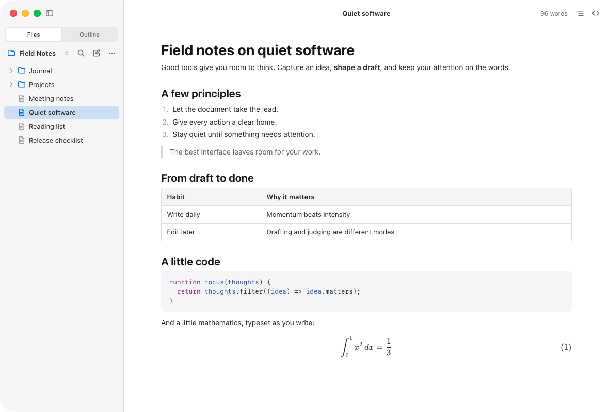

<p align="center">
  
</p>

<h1 align="center">Lettrine</h1>

<p align="center">A native Markdown editor for macOS that formats as you type.</p>

<p align="center">
  <a href="https://github.com/jason-bot-147/lettrine/actions/workflows/ci.yml"></a>
  <a href="LICENSE"></a>
  
</p>

<picture>
  <source media="(prefers-color-scheme: dark)" srcset="docs/images/lettrine-dark.png">
  
</picture>

Lettrine shows your Markdown as a finished document while you write it. Type `**bold**` and the asterisks stay visible until you close the pair, then fold away into bold text. Formulas and code open for editing when you click them, and ⌘/ shows the whole document as Markdown whenever you want it. The file on disk is always exactly the Markdown you wrote, down to the blank lines.

It's a small native Mac app: AppKit for windows, menus and files, and the system's WebKit for the page. There's no Electron, no bundled browser and no background server, and the whole app is about 15 MB, a 5 MB download.

A *lettrine* is a drop cap, the large letter that opens a chapter.

## Features

- **Writing in place.** Headings, emphasis, underline, links, images, lists and task lists, quotes, GitHub-style alerts, tables, footnotes and a table of contents all render as you type. Lists continue on Enter and nest with Tab; tables show row and column controls on hover.
- **Math and diagrams.** `$…$` and `$$` blocks are typeset with KaTeX, display equations are numbered so you can refer to them, and ` ```mermaid ` and ` ```zenuml ` fences become diagrams.
- **Code.** Fenced code is syntax-colored, and clicking it opens a real code editor for that language.
- **Source Code Mode.** ⌘/ shows the same document as plain Markdown, and ⌘/ again brings you back.
- **Folders.** Open a folder to browse it as a tree or a list, jump to any file with Quick Open (⇧⌘O) and search every file with Find in Folder (⇧⌘F). Rename, move, duplicate and trash files from the sidebar, with undo.
- **Careful with your files.** Saves are atomic, autosave is optional, earlier versions are kept as snapshots (File › Document History), and Lettrine notices when another app changes an open file. It can also bring back your windows, tabs and unsaved drafts the next time it opens.
- **Focus.** An outline in the sidebar, focus mode, typewriter mode, document zoom, word count and reading time.
- **Review.** Readonly mode protects the document, including source, code and formulas, while preserving the draft, caret and undo history.
- **Copy as Image.** Copy a rendered selection, formula, diagram or current view as a sharp PNG at twice its displayed size, in light and dark themes.
- **Export and import.** HTML, PDF and whole-document PNG/JPEG images are built in. Word, EPUB, RTF, OpenDocument, LaTeX, MediaWiki, reStructuredText, Textile and OPML work through [Pandoc](https://pandoc.org), which also turns Word, HTML, LaTeX and other documents into Markdown. Export settings and destinations are remembered.
- **Images.** Paste or drop images straight into an assets folder, rename or move image files without breaking the documents that use them, and optionally send pasted images to an upload service.
- **Typography.** Optional smart quotes, dashes and ellipses, shown in the view or written into the file, and optional subscript and superscript.
- **Your look.** Light and dark themes that follow macOS, custom CSS themes, and your choice of font, size, line height and page width.
- **At home on the Mac.** Window tabs, native menus, system spell checking, Read Aloud and rich-text paste converted to Markdown.
- **Languages.** English, Simplified Chinese and Traditional Chinese.

## Install

Lettrine runs on macOS 13 Ventura or later, on Apple silicon and Intel Macs.

1. Download `Lettrine-<version>.zip` from [Releases](https://github.com/jason-bot-147/lettrine/releases), unzip it and move **Lettrine** to your Applications folder.
2. Open it. Lettrine isn't notarized by Apple (that needs a paid developer account), so macOS asks you to confirm the first launch:
   - **macOS 15 or later:** open **System Settings › Privacy & Security** and click **Open Anyway**.
   - **macOS 13 or 14:** Control-click Lettrine in Finder, choose **Open**, then confirm.

To verify a download, also save `SHA256SUMS` from the release and run `shasum -a 256 -c SHA256SUMS` in the same folder. To update, replace the app with the latest release; **Lettrine › Check for Updates…** opens the releases page. You can also [build it yourself](#build-from-source).

## Privacy

Lettrine has no account, sync or analytics. Your documents stay where you keep them, and its settings, recent files and document history stay in `~/Library/Application Support/Lettrine`.

Lettrine goes online only to show web images that a document refers to, and to upload pasted images if you set up an uploader. Releases don't check for updates or send usage reports; Check for Updates… just opens the releases page in your browser.

## Keyboard shortcuts

| Action | Keys |
|---|---|
| Bold, italic, inline code, strikethrough | ⌘B, ⌘I, ⌘E, ⇧⌘X |
| Underline | ⇧⌘U |
| Link, image | ⌘K, ⇧⌘K |
| Heading 1–6, paragraph | ⌥⌘1–6, ⌘0 |
| Raise or lower a heading | ⌘=, ⌘- |
| Quote, code block, math block, table | ⌥⌘Q, ⌥⌘C, ⌥⌘B, ⌥⌘T |
| Source Code Mode | ⌘/ |
| Readonly Mode | ⌥⌘R |
| Find, find and replace | ⌘F, ⌥⌘F |
| Find in Folder, Quick Open | ⇧⌘F, ⇧⌘O |
| Sidebar, outline | ⌃⌘S, ⌃⌘O |
| Focus mode, typewriter mode | F8, F9 |
| Copy as Markdown | ⇧⌘C |

You can change any shortcut in Settings › Shortcuts. Help › Keyboard Shortcuts lists them all.

## Build from source

You need macOS 13 or later, the Xcode Command Line Tools (`xcode-select --install`) and Node.js 22 or later. Clone this repository, then run:

```sh
npm install
npm start
```

`npm start` builds `dist/development/Lettrine.app` for your Mac and opens it; drag it to Applications to keep it. `npm run dist` also packs it into a zip in `dist/`, and `npm run release:snapshot` builds a release for Apple silicon and Intel. See [Contributing](CONTRIBUTING.md#releases) for release commands. Builds are signed only for the Mac that made them, so a copy opened on another Mac needs approval once in System Settings › Privacy & Security.

Node.js is only needed to build and test. The app itself doesn't use it.

The [welcome tour](examples/hello.md) is a document that exercises most features; open it in Lettrine to try them.

## Contributing

Bug reports and pull requests are welcome. [CONTRIBUTING.md](CONTRIBUTING.md) explains how to build the app, run the tests and keep the editor's guarantees. Please follow the [Code of Conduct](CODE_OF_CONDUCT.md), and report security problems privately as the [security policy](SECURITY.md) describes. Changes are listed in the [changelog](CHANGELOG.md).

## License

Lettrine is released under the [MIT License](LICENSE). It includes CodeMirror, KaTeX, Mermaid and its ZenUML plugin, markdown-it and GitHub's emoji names; see [third-party notices](THIRD_PARTY_NOTICES.md). Lettrine was called mdlive during early development.
