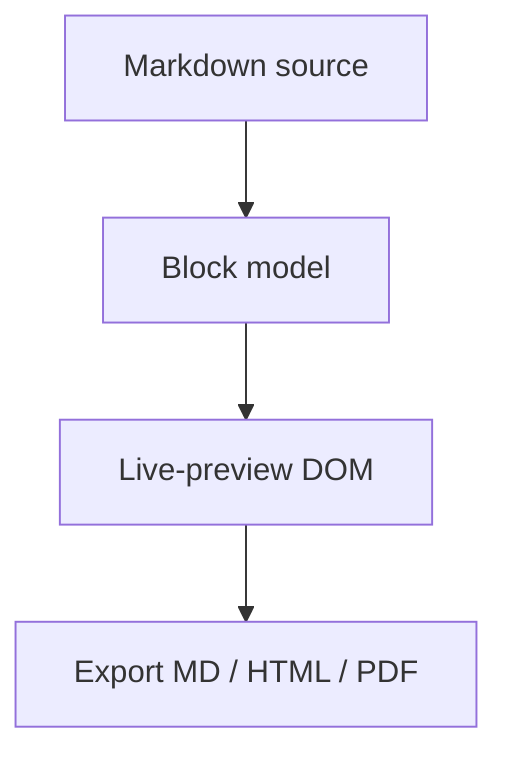

# Welcome to Lettrine

Lettrine is an **open-source** Markdown editor with *live preview*: type Markdown and watch it render in place.

## Things to try

### Inline styles (markers hide when complete)

Type `**bold**`, `*italic*`, `~~strike~~`, `==highlight==`, `` `code` ``, a [link](https://example.com), or an autolink: https://pandoc.org

### Lists and tasks

- bullet one
  - nested item
- [x] completed task
- [ ] try checking this one (click the box)

Numbered lists count for you:

1. ordered one
2. ordered two — press **Enter** here and it continues with `3.`

### Code and math

```js
function greet(name) {
  return `Hello, ${name}!`;
}
```

Inline math: $E = mc^2$ and a block:

$$
\int_{-\infty}^{\infty} e^{-x^2}\,dx = \sqrt{\pi}
$$

### A diagram (rendered with mermaid)



### Table (press Enter inside a cell for a new row)

| Feature | Status |
| ------- | ------ |
| Live preview | done |
| Themes | light and dark, plus your own CSS |
| Export | md / html / pdf / pandoc |

---

> Quoted text renders with a quote bar.
>
> Press **Backspace** at the start of a line to join it with the previous block.

### Shortcuts

| Keys | Action |
| ---- | ------ |
| ⌘B / ⌘I / ⇧⌘X / ⌘E | bold / italic / strike / code |
| ⌘K / ⇧⌘K | link / image |
| ⌥⌘1–6, ⌘0 | heading level / paragraph |
| ⌘= / ⌘- | raise / lower heading level |
| ⌘L | select line |
| ⌘F / ⌥⌘F | find / find and replace |
| ⇧⌘F | find in folder |
| ⇧⌘O | open quickly |
| ⌘/ | source code mode |
| ⌃⌘S / ⌃⌘O | sidebar / outline |
| F8 / F9 | focus / typewriter mode |
| Esc | insert the chosen emoji (`:smile:` → 😄) |

Happy writing!
